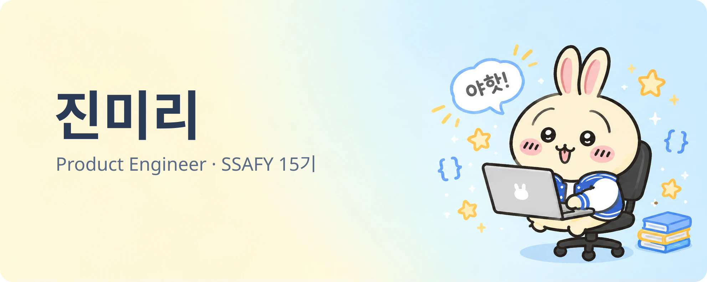
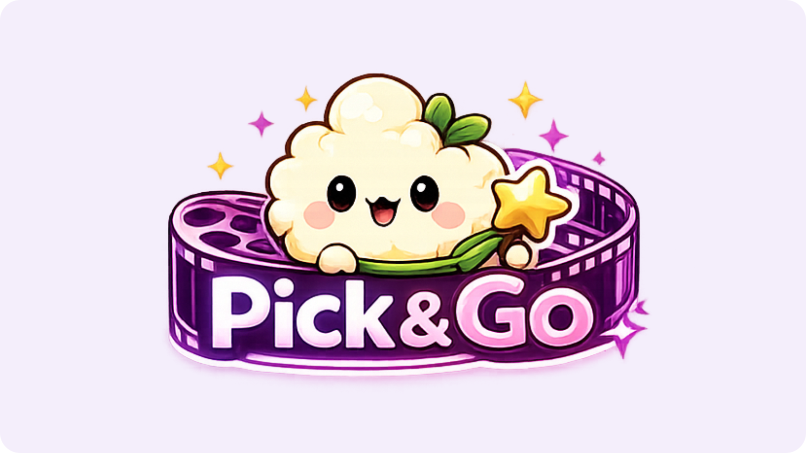
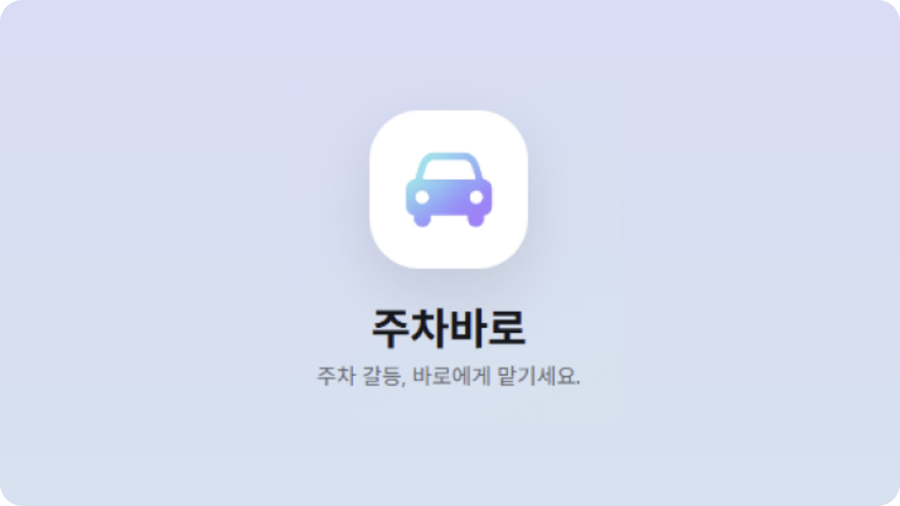

  

<h3 align="center">우사기처럼 즐겁게 협업하는 Product Engineer</h3>

  화면부터 서버·AI·인프라까지, 직접 만든 서비스를 코드 단위로 이해하려는 SSAFY 15기 진미리입니다.

  <b>🏆 프로젝트 수상 3회</b> &nbsp;·&nbsp; <b>📱 앱 스토어 출시</b> &nbsp;·&nbsp; <b>🧭 프론트·백엔드·AI·인프라</b> &nbsp;·&nbsp; <b>🗂 Jira 이슈 503건</b>

  
  

---

## 👋 About

- 👑 AI 영화 추천 서비스 **Pick & Go** 팀장으로 최우수상, 발표 뒤에도 직접 무료 배포·운영
- 📱 부산 여행 앱 **GABOLLE** 웹·앱 화면을 만들어 Google Play · App Store 출시
- 🚗 AIoT 주차 관리 서비스 **주차바로**에서 차량 추적과 주차 위반 판정 규칙 구현
- 🛡 기업연계 프로젝트 **쿠킹테이블**에서 팀 서버 인프라 담당 — 네트워크·로그인 서비스·보안·백업
- 📝 프로젝트마다 <b>부딪힌 문제와 고른 선택지(A안·B안)</b>를 남기고, 코드를 다시 읽은 기록은 벨로그에 써요
- 🗂 팀 프로젝트 코드는 SSAFY GitLab에서 작업했어요. 이 GitHub는 프로젝트를 모아 둔 **기록용**이라 잔디가 적어요

## 🚀 Projects

<table>
  <tr>
    <td width="50%" valign="top">
      
      <h4>🎬 Pick & Go</h4>
      AI 영화 추천 웹 서비스 
      🏆 관통 프로젝트 <b>최우수</b> 
      👑 <b>팀장</b> · 프론트엔드 · 백엔드 · UI/UX  
      <a href="https://github.com/jinmiri-dev/MIRI_SSAFY/tree/main/1학기_픽앤고_영화추천사이트">📄 프로젝트</a> ·
      <a href="https://github.com/jinmiri-dev/MIRI_SSAFY/blob/main/1학기_픽앤고_영화추천사이트/내가_한_일.md">🙋 내 역할·판단</a> ·
      <a href="https://pick-and-go-2z6d.onrender.com">🔗 서비스</a> ·
      <a href="https://velog.io/@bara0121/series/%EA%B4%80%ED%86%B5-AI-%EC%98%81%ED%99%94-%EC%B6%94%EC%B2%9C-%EC%84%9C%EB%B9%84%EC%8A%A4">✍️ 블로그</a>
    </td>
    <td width="50%" valign="top">
      
      <h4>🚗 주차바로</h4>
      AIoT 주차 관리 서비스 
      🏆 공통 프로젝트 <b>우수</b> 
      👩‍💻 AI · 추적 · 위반 판정  
      <a href="https://github.com/jinmiri-dev/MIRI_SSAFY/tree/main/2학기_주차바로_AIoT">📄 프로젝트·영상·장표</a> ·
      <a href="https://github.com/jinmiri-dev/MIRI_SSAFY/blob/main/2학기_주차바로_AIoT/내가_한_일.md">🙋 내 역할·판단</a> ·
      <a href="https://velog.io/@bara0121/series/%EC%98%81%EC%83%81-AI-%EC%8B%A4%EC%A0%84-%EB%85%B8%ED%8A%B8">✍️ 블로그</a>
    </td>
  </tr>
  <tr>
    <td width="50%" valign="top">
      
      <h4>🌉 GABOLLE (가볼래)</h4>
      부산 초개인화 여행 추천 앱 
      🏆 특화 프로젝트 <b>우수</b> 
      👩‍💻 웹·앱 프론트엔드  
      <a href="https://github.com/jinmiri-dev/MIRI_SSAFY/tree/main/2학기_가볼래_빅데이터_분산">📄 프로젝트·영상·장표</a> ·
      <a href="https://github.com/jinmiri-dev/MIRI_SSAFY/blob/main/2학기_가볼래_빅데이터_분산/내가_한_일.md">🙋 내 역할·판단</a> ·
      <a href="https://play.google.com/store/apps/details?id=com.gabolle.app">Google Play</a> ·
      <a href="https://apps.apple.com/kr/app/%EA%B0%80%EB%B3%BC%EB%9E%98-gabolle/id6811252919">App Store</a> ·
      <a href="https://velog.io/@bara0121/series/%ED%8A%B9%ED%99%94-%EB%B6%80%EC%82%B0-%EC%97%AC%ED%96%89-%EC%B6%94%EC%B2%9C-%EC%95%B1">✍️ 블로그</a>
    </td>
    <td width="50%" valign="top">
      
      <h4>🧑‍🍳 쿠킹테이블</h4>
      요리 영상을 레시피로 나누는 AI 서비스 · 기업연계 
      🎤 자율 프로젝트 <b>발표 완료</b> (결과 발표 전) 
      🛡 <b>인프라</b> · 로그인 서비스 · 앱 화면  
      <a href="https://github.com/jinmiri-dev/MIRI_SSAFY/tree/main/2학기_쿠킹테이블__기업연계">📄 프로젝트·영상·장표</a> ·
      <a href="https://github.com/jinmiri-dev/MIRI_SSAFY/blob/main/2학기_쿠킹테이블__기업연계/내가_한_일.md">🙋 내 역할·판단</a> ·
      <a href="https://velog.io/@bara0121/series/%EC%9E%90%EC%9C%A8-%EC%9A%94%EB%A6%AC-%EC%98%81%EC%83%81-%EB%A0%88%EC%8B%9C%ED%94%BC-%EC%84%9C%EB%B9%84%EC%8A%A4">✍️ 블로그</a>
    </td>
  </tr>
</table>

## 🧭 해 본 일과 기술

<table>
  <tr><th width="110">영역</th><th>해 본 일</th><th width="300">주로 쓴 기술</th></tr>
  <tr><td align="center"><b>Frontend</b></td><td>Vue 3 웹, React Native(Expo) 앱·웹 화면, 5개 언어, 앱 스토어 출시</td><td>   </td></tr>
  <tr><td align="center"><b>Backend</b></td><td>Django API·배치, Spring Boot 로그인 서비스(OAuth·JWT), 화면에 필요한 API</td><td>  </td></tr>
  <tr><td align="center"><b>AI</b></td><td>차량 추적·주차 위반 판정 규칙, LLM 추천·검열, 요리 영상 단계 판독 실험</td><td>  </td></tr>
  <tr><td align="center"><b>Infra</b></td><td>무료 배포(Render·Neon), 팀 서버 Nginx·HTTPS·방화벽·SSH 보안·암호화 백업</td><td>  </td></tr>
  <tr><td align="center"><b>협업</b></td><td>Jira 이슈 단위 작업, GitLab MR, 디자인 시안</td><td>  </td></tr>
</table>

## 🏆 수상 · 활동

<table>
  <tr><th width="110">구분</th><th>내용</th><th width="190">역할</th></tr>
  <tr><td align="center">🙋 활동</td><td><b>SSAFY 부울경 1반 CA</b> (Class Ambassador)</td><td>자치회 활동</td></tr>
  <tr><td align="center">🥇 최우수</td><td><b>광주 캠퍼스 SSAFY MeetUp! 쇼미더아이디어</b> · 상금 30만원</td><td>개발 언어 선택을 주제로 한 콩트 형식 발표 (5인 1팀)</td></tr>
  <tr><td align="center">🥇 최우수</td><td><b>관통 프로젝트</b> · AI 영화 추천 서비스 Pick & Go</td><td><b>팀장</b></td></tr>
  <tr><td align="center">🥈 우수</td><td><b>공통 프로젝트</b> · AIoT 주차 관리 서비스 주차바로</td><td>AI 담당</td></tr>
  <tr><td align="center">🥈 우수</td><td><b>특화 프로젝트</b> · 부산 여행 추천 서비스 GABOLLE(가볼래)</td><td>프론트엔드 담당</td></tr>
  <tr><td align="center">🎤 발표</td><td><b>자율 프로젝트(기업연계)</b> · 요리 영상 레시피 서비스 쿠킹테이블 · 결과 발표 전</td><td>인프라 담당</td></tr>
</table>

<b>📜 상장 보기</b>

 
<table>
  <tr>
    <td align="center" width="33%">
       
      <b>1학기 관통 프로젝트 최우수상</b> · Pick & Go
    </td>
    <td align="center" width="33%">
       
      <b>2학기 공통 프로젝트 우수상</b> · 주차바로
    </td>
    <td align="center" width="33%">
       
      <b>2학기 특화 프로젝트 우수상</b> · GABOLLE
    </td>
  </tr>
</table>
이미지를 누르면 원본 크기로 볼 수 있어요.

