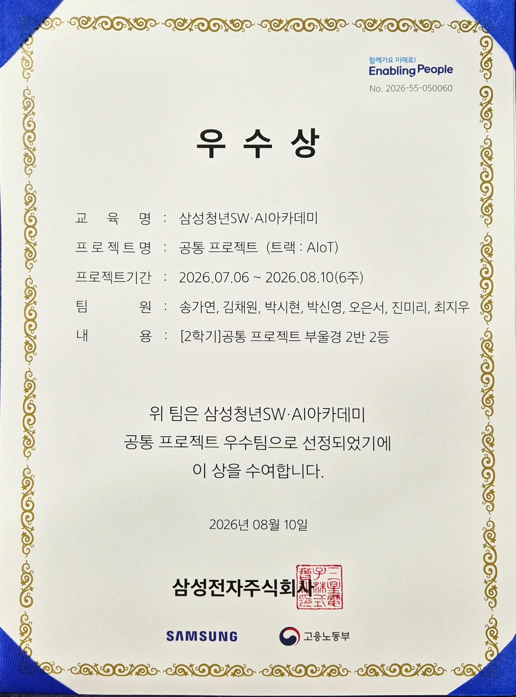

  

<h3 align="center">우사기처럼 즐겁게 협업하는 Product Engineer</h3>

  화면부터 서버·AI·인프라까지, 직접 만든 서비스를 코드 단위로 이해하려는 SSAFY 15기 진미리입니다.

  
  
  

---

## 👋 About

- 🏆 SSAFY 15기 프로젝트 **3회 연속 수상** — 관통 최우수 · 공통 우수 · 특화 우수 (자율 프로젝트는 결과 발표 전)
- 🧭 네 번의 프로젝트에서 **프론트엔드 · 백엔드 · AI · 인프라**를 모두 맡아 봤어요
- 👑 AI 영화 추천 서비스 **Pick & Go** 팀장, 발표 후에도 직접 무료 배포·운영
- 🛡 기업연계 프로젝트 **쿠킹테이블**에서 팀 서버 인프라 담당 — 네트워크·로그인 서비스·보안·백업
- 📝 README를 넘어, 코드를 다시 읽으며 "왜 이렇게 만들었는지"를 벨로그에 기록해요
- 🗂 팀 프로젝트 코드는 SSAFY GitLab에서 작업했어요. 이 GitHub는 프로젝트를 모아 둔 **기록용**이라 잔디가 적어요

## 🧭 해 본 일

| 영역 | 프로젝트 | 한 일 |
|:---:|---|---|
| **Frontend** | Pick & Go · GABOLLE · 쿠킹테이블 | Vue 3 웹, React Native(Expo) 앱·웹 화면, 5개 언어, 앱 스토어 출시 |
| **Backend** | Pick & Go · GABOLLE · 쿠킹테이블 | Django API·배치, Spring Boot 로그인 서비스(OAuth·JWT), 화면에 필요한 API |
| **AI** | 주차바로 · Pick & Go · 쿠킹테이블 | 차량 추적·주차 위반 판정 규칙, LLM 추천·검열, 요리 영상 단계 판독 실험 |
| **Infra** | Pick & Go · 쿠킹테이블 | 무료 배포(Render·Neon), 팀 서버 Nginx·HTTPS·방화벽·SSH 보안·암호화 백업 |

## 🛠 Tech Stack

<table>
  <tr>
    <td align="center" width="140"><b>Frontend</b></td>
    <td>
      
      
      
      
    </td>
  </tr>
  <tr>
    <td align="center"><b>Mobile</b></td>
    <td>
      
      
    </td>
  </tr>
  <tr>
    <td align="center"><b>Backend</b></td>
    <td>
      
      
      
      
    </td>
  </tr>
  <tr>
    <td align="center"><b>AI</b></td>
    <td>
      
      
      
      
    </td>
  </tr>
  <tr>
    <td align="center"><b>Infra</b></td>
    <td>
      
      
      
      
      
    </td>
  </tr>
  <tr>
    <td align="center"><b>Collaboration</b></td>
    <td>
      
      
      
      
      
    </td>
  </tr>
</table>

## 🚀 Projects

<table>
  <tr>
    <td width="50%" valign="top">
      
      <h4>🎬 Pick & Go</h4>
      AI 영화 추천 웹 서비스 
      🏆 관통 프로젝트 <b>최우수</b> 
      👑 <b>팀장</b> · 프론트엔드 · 백엔드 · UI/UX  
      <a href="https://github.com/jinmiri-dev/MIRI_SSAFY/tree/main/1학기_픽앤고_영화추천사이트">소개</a> ·
      <a href="https://github.com/jinmiri-dev/MIRI_SSAFY/blob/main/1학기_픽앤고_영화추천사이트/내가_한_일.md">내가 한 일</a> ·
      <a href="https://pick-and-go-2z6d.onrender.com">서비스</a> ·
      <a href="https://velog.io/@bara0121/series/%EA%B4%80%ED%86%B5-AI-%EC%98%81%ED%99%94-%EC%B6%94%EC%B2%9C-%EC%84%9C%EB%B9%84%EC%8A%A4">코드 기록</a>
    </td>
    <td width="50%" valign="top">
      
      <h4>🚗 주차바로</h4>
      AIoT 주차 관리 서비스 
      🏆 공통 프로젝트 <b>우수</b> 
      👩‍💻 AI · 추적 · 위반 판정  
      <a href="https://github.com/jinmiri-dev/MIRI_SSAFY/tree/main/2학기_주차바로_AIoT#-영상-포트폴리오">🎬 영상</a> ·
      <a href="https://github.com/jinmiri-dev/MIRI_SSAFY/tree/main/2학기_주차바로_AIoT">소개</a> ·
      <a href="https://github.com/jinmiri-dev/MIRI_SSAFY/blob/main/2학기_주차바로_AIoT/내가_한_일.md">내가 한 일</a> ·
      <a href="https://velog.io/@bara0121/series/%EC%98%81%EC%83%81-AI-%EC%8B%A4%EC%A0%84-%EB%85%B8%ED%8A%B8">코드 기록</a>
    </td>
  </tr>
  <tr>
    <td width="50%" valign="top">
      
      <h4>🌉 GABOLLE (가볼래)</h4>
      부산 초개인화 여행 추천 앱 
      🏆 특화 프로젝트 <b>우수</b> 
      👩‍💻 웹·앱 프론트엔드  
      <a href="https://github.com/jinmiri-dev/MIRI_SSAFY/tree/main/2학기_가볼래_빅데이터_분산#-영상-포트폴리오">🎬 영상</a> ·
      <a href="https://github.com/jinmiri-dev/MIRI_SSAFY/tree/main/2학기_가볼래_빅데이터_분산">소개</a> ·
      <a href="https://github.com/jinmiri-dev/MIRI_SSAFY/blob/main/2학기_가볼래_빅데이터_분산/내가_한_일.md">내가 한 일</a> ·
      <a href="https://play.google.com/store/apps/details?id=com.gabolle.app">Google Play</a> ·
      <a href="https://apps.apple.com/kr/app/%EA%B0%80%EB%B3%BC%EB%9E%98-gabolle/id6811252919">App Store</a> ·
      <a href="https://velog.io/@bara0121/series/%ED%8A%B9%ED%99%94-%EB%B6%80%EC%82%B0-%EC%97%AC%ED%96%89-%EC%B6%94%EC%B2%9C-%EC%95%B1">코드 기록</a>
    </td>
    <td width="50%" valign="top">
      
      <h4>🧑‍🍳 쿠킹테이블</h4>
      요리 영상을 레시피로 나누는 AI 서비스 · 기업연계 
      🎤 자율 프로젝트 <b>발표 완료</b> (결과 발표 전) 
      🛡 <b>인프라</b> · 로그인 서비스 · 앱 화면  
      <a href="https://github.com/jinmiri-dev/MIRI_SSAFY/tree/main/2학기_쿠킹테이블__기업연계#-홍보-영상">🎬 영상</a> ·
      <a href="https://github.com/jinmiri-dev/MIRI_SSAFY/tree/main/2학기_쿠킹테이블__기업연계">소개</a> ·
      <a href="https://github.com/jinmiri-dev/MIRI_SSAFY/blob/main/2학기_쿠킹테이블__기업연계/내가_한_일.md">내가 한 일</a> ·
      <a href="https://velog.io/@bara0121/series/%EC%9E%90%EC%9C%A8-%EC%9A%94%EB%A6%AC-%EC%98%81%EC%83%81-%EB%A0%88%EC%8B%9C%ED%94%BC-%EC%84%9C%EB%B9%84%EC%8A%A4">코드 기록</a>
    </td>
  </tr>
</table>

## 🏆 수상 · 활동

| 구분 | 내용 | 역할 |
|:---:|---|---|
| 🙋&nbsp;활동 | **SSAFY 부울경 1반 CA** (Class Ambassador) | 자치회 활동 |
| 🥇&nbsp;최우수 | **광주 캠퍼스 SSAFY MeetUp! 쇼미더아이디어** · 상금 30만원 | 개발 언어 선택을 주제로 한 콩트 형식 발표 (5인 1팀) |
| 🥇&nbsp;최우수 | **관통 프로젝트** · AI 영화 추천 서비스 Pick & Go | **팀장** |
| 🥈&nbsp;우수 | **공통 프로젝트** · AIoT 주차 관리 서비스 주차바로 | AI 담당 |
| 🥈&nbsp;우수 | **특화 프로젝트** · 부산 여행 추천 서비스 GABOLLE(가볼래) · 반 2등 | 프론트엔드 담당 |
| 🎤&nbsp;발표 | **자율 프로젝트(기업연계)** · 요리 영상 레시피 서비스 쿠킹테이블 · 결과 발표 전 | 인프라 담당 |

<b>📜 상장 보기</b>

 
<table>
  <tr>
    <td align="center" width="33%">
       
      <b>1학기 관통 프로젝트 최우수상</b> · Pick & Go
    </td>
    <td align="center" width="33%">
       
      <b>2학기 공통 프로젝트 우수상</b> · 주차바로
    </td>
    <td align="center" width="33%">
       
      <b>2학기 특화 프로젝트 우수상</b> · GABOLLE
    </td>
  </tr>
</table>
이미지를 누르면 원본 크기로 볼 수 있어요.

---

  <a href="https://github.com/jinmiri-dev/MIRI_SSAFY"><b>📁 프로젝트별 README · 내가 한 일 · 벨로그 기록 모아 보기 — MIRI_SSAFY</b></a>

