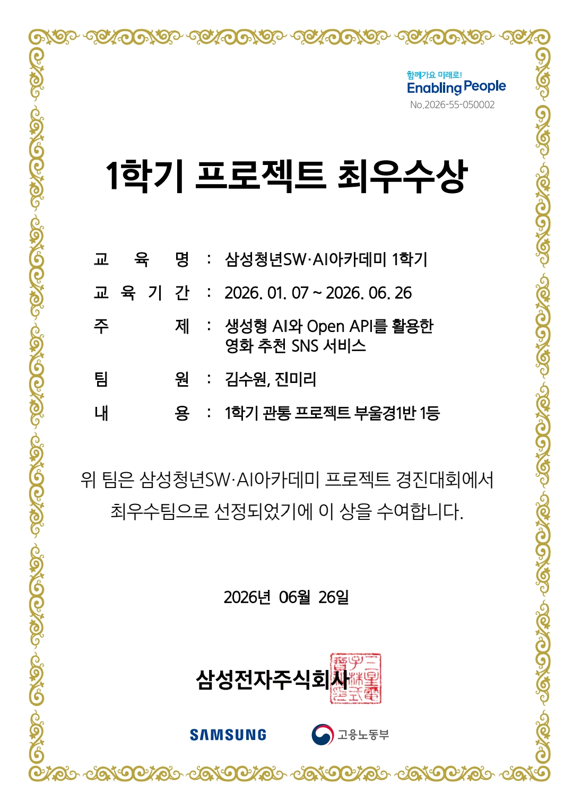
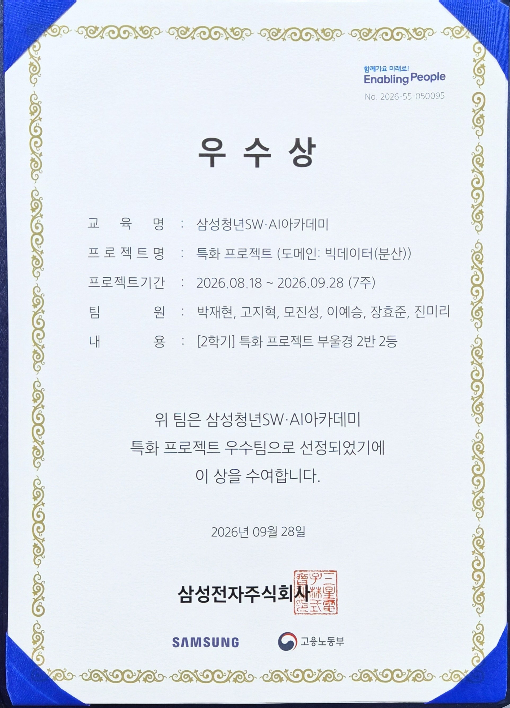

  

<h3 align="center">우사기처럼 즐겁게 협업하는 Product Engineer</h3>

  화면부터 서버·AI·인프라까지, 직접 만든 서비스를 코드 단위로 이해하려는 SSAFY 15기 진미리입니다.

  <b>🏆 프로젝트 수상 3회</b> &nbsp;·&nbsp; <b>📱 앱 스토어 출시</b> &nbsp;·&nbsp; <b>🧭 프론트·백엔드·AI·인프라</b> &nbsp;·&nbsp; <b>🗂 Jira 이슈 503건</b>

  
  

---

## 👋 About

- 네 번의 SSAFY 프로젝트에서 **프론트엔드 · 백엔드 · AI · 인프라**를 차례로 맡았어요
- 문제를 만나면 선택지를 나란히 놓고 **왜 그 길을 골랐는지** 기록해요. 아래 카드마다 문제 해결 사례를 하나씩 적었어요
- 팀 프로젝트 코드는 SSAFY GitLab에서 작업했어요. 이 GitHub는 프로젝트를 모아 둔 **기록용**이라 잔디가 적어요

## 🚀 Projects

<table>
  <tr>
    <td width="50%" valign="top">
      
      <h4>🎬 Pick & Go</h4>
       <b>팀을 이끌고 기능 범위·일정 결정</b> 
       <b>Vue 화면</b> 
       <b>Django API</b>  
      AI 영화 추천 웹 서비스 
      🏆 관통 프로젝트 <b>최우수</b> 
       
      <b>맡은 일</b> · Vue 화면과 Django API를 함께 만들고, 발표 뒤 직접 무료 배포  
      <b>🔧 문제 해결</b> 
      영화 수백 편의 AI 점수를 화면 열 때마다 물으면 느리고 AI가 멈추면 화면도 멈춤 
      → 사용자별이 아니라 MVTI 유형 16개 단위로 미리 계산(배치) 
      → 화면은 DB 조회 한 번, AI가 멈춰도 추천은 그대로  
      <a href="https://github.com/jinmiri-dev/MIRI_SSAFY/tree/main/1학기_픽앤고_영화추천사이트">📄 프로젝트</a> · <a href="https://github.com/jinmiri-dev/MIRI_SSAFY/blob/main/1학기_픽앤고_영화추천사이트/내가_한_일.md">🔧 문제 해결 더 보기</a> · <a href="https://pick-and-go-2z6d.onrender.com">🔗 서비스</a> · <a href="https://velog.io/@bara0121/series/%EA%B4%80%ED%86%B5-AI-%EC%98%81%ED%99%94-%EC%B6%94%EC%B2%9C-%EC%84%9C%EB%B9%84%EC%8A%A4">✍️ 블로그</a>
    </td>
    <td width="50%" valign="top">
      
      <h4>🚗 주차바로</h4>
       <b>차량 추적 · 위반 판정</b>  
      AIoT 주차 관리 서비스 
      🏆 공통 프로젝트 <b>우수</b> 
       
      <b>맡은 일</b> · 천장 카메라 차량 추적, 이중주차·전기차 등 위반 판정 규칙, 백엔드 연동  
      <b>🔧 문제 해결</b> 
      장애인·전기차 구역 자격 정보가 아직 연결되지 않은 차량 
      → 위반으로 신고하지 않고 "후보"로 보류 
      → 정상 차량을 잘못 신고하지 않고, 정보가 채워지면 정상 판정  
      <a href="https://github.com/jinmiri-dev/MIRI_SSAFY/tree/main/2학기_주차바로_AIoT">📄 프로젝트·영상·장표</a> · <a href="https://github.com/jinmiri-dev/MIRI_SSAFY/blob/main/2학기_주차바로_AIoT/내가_한_일.md">🔧 문제 해결 더 보기</a> · <a href="https://velog.io/@bara0121/series/%EC%98%81%EC%83%81-AI-%EC%8B%A4%EC%A0%84-%EB%85%B8%ED%8A%B8">✍️ 블로그</a>
    </td>
  </tr>
  <tr>
    <td width="50%" valign="top">
      
      <h4>🌉 GABOLLE (가볼래)</h4>
       <b>앱 · 웹 화면</b> 
       <b>화면용 API 일부</b>  
      부산 초개인화 여행 추천 앱 
      🏆 특화 프로젝트 <b>우수</b> 
       
      <b>맡은 일</b> · React Native(Expo) 한 코드로 앱·웹 화면, 5개 언어, 스토어 출시  
      <b>🔧 문제 해결</b> 
      숫자가 낀 문구 208곳이 일본어·중국어 화면에서 영어로 나옴 
      → 호출부 208곳 대신 번역을 찾는 함수 하나만 "숫자 뺀 모양"으로 수정 
      → 208곳 한 번에 해결, 번역 누락은 CI 검사로 재발 방지  
      <a href="https://github.com/jinmiri-dev/MIRI_SSAFY/tree/main/2학기_가볼래_빅데이터_분산">📄 프로젝트·영상·장표</a> · <a href="https://github.com/jinmiri-dev/MIRI_SSAFY/blob/main/2학기_가볼래_빅데이터_분산/내가_한_일.md">🔧 문제 해결 더 보기</a> · <a href="https://play.google.com/store/apps/details?id=com.gabolle.app">Google Play</a> · <a href="https://apps.apple.com/kr/app/%EA%B0%80%EB%B3%BC%EB%9E%98-gabolle/id6811252919">App Store</a> · <a href="https://velog.io/@bara0121/series/%ED%8A%B9%ED%99%94-%EB%B6%80%EC%82%B0-%EC%97%AC%ED%96%89-%EC%B6%94%EC%B2%9C-%EC%95%B1">✍️ 블로그</a>
    </td>
    <td width="50%" valign="top">
      
      <h4>🧑‍🍳 쿠킹테이블</h4>
       <b>서버 · 보안 · 백업</b> 
       <b>로그인 서비스</b> 
       <b>앱 화면</b>  
      요리 영상을 레시피로 나누는 AI 서비스 · 기업연계 
      🎤 자율 프로젝트 <b>발표 완료</b> (결과 발표 전) 
       
      <b>맡은 일</b> · 팀 서버 Nginx·HTTPS, 카카오·네이버·구글 로그인 서비스, 보안 점검, 암호화 백업  
      <b>🔧 문제 해결</b> 
      12MB 영상 업로드가 서버 문 앞(Nginx)에서 413으로 막힘 
      → API 전체 한도를 올리지 않고 업로드 경로만 34MB로 따로 열기 
      → 업로드는 통과, 다른 API는 10MB 그대로 보호  
      <a href="https://github.com/jinmiri-dev/MIRI_SSAFY/tree/main/2학기_쿠킹테이블__기업연계">📄 프로젝트·영상·장표</a> · <a href="https://github.com/jinmiri-dev/MIRI_SSAFY/blob/main/2학기_쿠킹테이블__기업연계/내가_한_일.md">🔧 문제 해결 더 보기</a> · <a href="https://velog.io/@bara0121/series/%EC%9E%90%EC%9C%A8-%EC%9A%94%EB%A6%AC-%EC%98%81%EC%83%81-%EB%A0%88%EC%8B%9C%ED%94%BC-%EC%84%9C%EB%B9%84%EC%8A%A4">✍️ 블로그</a>
    </td>
  </tr>
</table>

## 🧭 해 본 일과 기술

<table>
  <tr><th width="130">영역</th><th>해 본 일</th><th width="300">주로 쓴 기술</th></tr>
  <tr><td align="center"></td><td>Vue 3 웹, React Native(Expo) 앱·웹 화면, 5개 언어, 앱 스토어 출시 근거 → <a href="https://github.com/jinmiri-dev/MIRI_SSAFY/blob/main/2학기_가볼래_빅데이터_분산/내가_한_일.md">가볼래 · 208곳 번역 한 번에</a> · <a href="https://github.com/jinmiri-dev/MIRI_SSAFY/blob/main/2학기_가볼래_빅데이터_분산/내가_한_일.md">가볼래 · 동시 401 갱신</a></td><td>   </td></tr>
  <tr><td align="center"></td><td>Django API·배치, Spring Boot 로그인 서비스(OAuth·JWT), 화면에 필요한 API 근거 → <a href="https://github.com/jinmiri-dev/MIRI_SSAFY/blob/main/2학기_쿠킹테이블__기업연계/내가_한_일.md">쿠킹테이블 · 로그인 서비스 설계</a> · <a href="https://github.com/jinmiri-dev/MIRI_SSAFY/blob/main/1학기_픽앤고_영화추천사이트/내가_한_일.md">픽앤고 · AI 점수 배치·N+1</a></td><td>  </td></tr>
  <tr><td align="center"></td><td>차량 추적·주차 위반 판정 규칙, LLM 추천·검열, 요리 영상 단계 판독 실험 근거 → <a href="https://github.com/jinmiri-dev/MIRI_SSAFY/blob/main/2학기_주차바로_AIoT/내가_한_일.md">주차바로 · 추적·위반 판정</a> · <a href="https://github.com/jinmiri-dev/MIRI_SSAFY/blob/main/1학기_픽앤고_영화추천사이트/내가_한_일.md">픽앤고 · AI 실패 시 처리</a></td><td>  </td></tr>
  <tr><td align="center"></td><td>무료 배포(Render·Neon), 팀 서버 Nginx·HTTPS·방화벽·SSH 보안·암호화 백업 근거 → <a href="https://github.com/jinmiri-dev/MIRI_SSAFY/blob/main/2학기_쿠킹테이블__기업연계/내가_한_일.md">쿠킹테이블 · Nginx·SSH·백업</a> · <a href="https://github.com/jinmiri-dev/MIRI_SSAFY/blob/main/1학기_픽앤고_영화추천사이트/내가_한_일.md">픽앤고 · 무료 배포</a></td><td>  </td></tr>
  <tr><td align="center"><b>협업</b></td><td>Jira 이슈 단위 작업, GitLab MR, 디자인 시안 AI 에이전트 여럿이 한 저장소에서 일할 때, 팀원이 만든 오픈소스 <a href="https://www.npmjs.com/package/axmap-cli">axMap</a>으로 작업 범위를 먼저 잡고 맥락을 쪽지로 남기며 협업</td><td>  </td></tr>
</table>

## 🏆 수상 · 활동

<table>
  <tr><th width="110">구분</th><th>내용</th><th width="190">역할</th></tr>
  <tr><td align="center">🙋 활동</td><td><b>SSAFY 부울경 1반 CA</b> (Class Ambassador)</td><td>자치회 활동</td></tr>
  <tr><td align="center">🥇 최우수</td><td><b>광주 캠퍼스 SSAFY MeetUp! 쇼미더아이디어</b> · 상금 30만원</td><td>개발 언어 선택을 주제로 한 콩트 형식 발표 (5인 1팀)</td></tr>
  <tr><td align="center">🥇 최우수</td><td><b>관통 프로젝트</b> · AI 영화 추천 서비스 Pick & Go</td><td><b>팀장</b></td></tr>
  <tr><td align="center">🥈 우수</td><td><b>공통 프로젝트</b> · AIoT 주차 관리 서비스 주차바로</td><td>AI 담당</td></tr>
  <tr><td align="center">🥈 우수</td><td><b>특화 프로젝트</b> · 부산 여행 추천 서비스 GABOLLE(가볼래)</td><td>프론트엔드 담당</td></tr>
  <tr><td align="center">🎤 발표</td><td><b>자율 프로젝트(기업연계)</b> · 요리 영상 레시피 서비스 쿠킹테이블 · 결과 발표 전</td><td>인프라 담당</td></tr>
</table>

<b>📜 상장 보기</b>

 
<table>
  <tr>
    <td align="center" width="33%">
       
      <b>1학기 관통 프로젝트 최우수상</b> · Pick & Go
    </td>
    <td align="center" width="33%">
       
      <b>2학기 공통 프로젝트 우수상</b> · 주차바로
    </td>
    <td align="center" width="33%">
       
      <b>2학기 특화 프로젝트 우수상</b> · GABOLLE
    </td>
  </tr>
</table>
이미지를 누르면 원본 크기로 볼 수 있어요.

