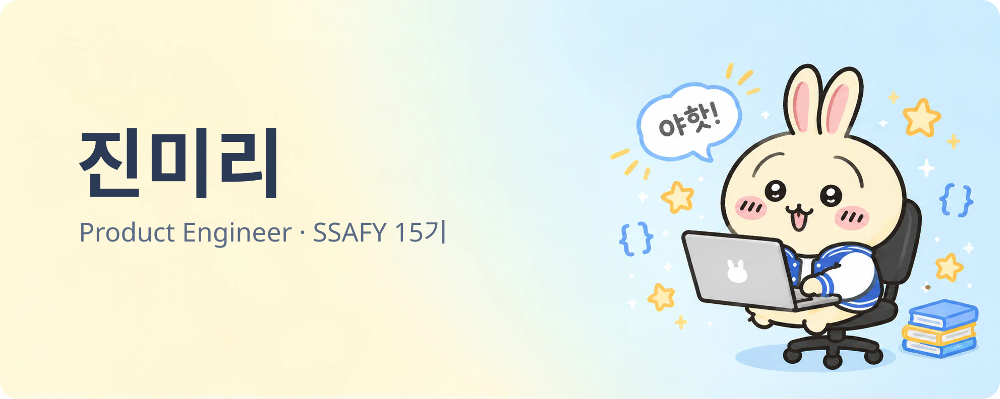
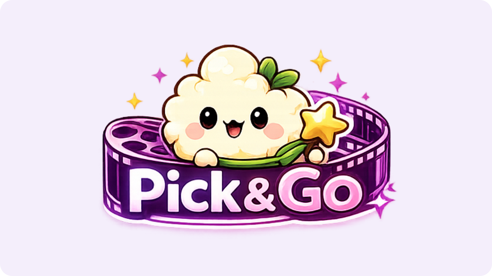
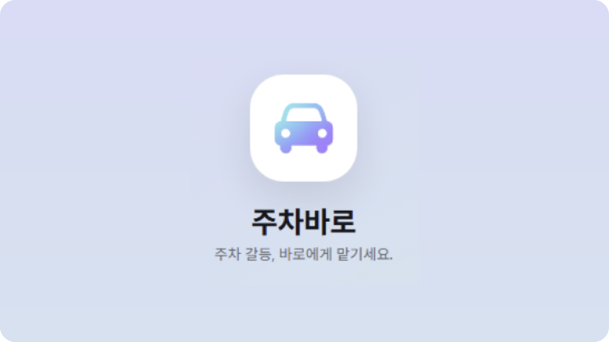
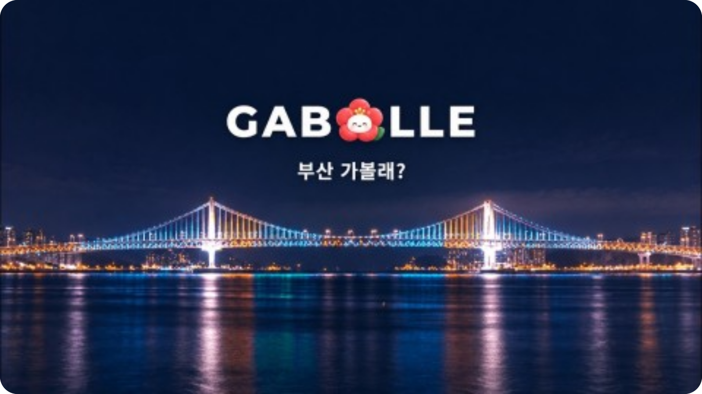

  

<h3 align="center">우사기처럼 즐겁게 협업하는 Product Engineer</h3>

  화면부터 그 뒤의 AI·서버까지, 직접 만든 서비스를 코드 단위로 이해하려는 SSAFY 15기 진미리입니다.

  
  

---

## 👋 About

- 🏆 SSAFY 15기 프로젝트 3회 연속 수상 — 관통 최우수 · 공통 우수 · 특화 우수
- 👑 AI 영화 추천 서비스 **Pick & Go** **팀장**으로 최우수상, 발표 후에도 실제 서비스로 무료 배포·운영
- 📱 부산 여행 앱 **GABOLLE** 웹·앱 프론트엔드 개발, Google Play · App Store 출시
- 📝 README를 넘어, 프로젝트 코드를 다시 읽으며 "왜 이렇게 만들었는지"를 벨로그에 기록해요

## 🛠 Tech Stack

<table>
  <tr>
    <td align="center" width="140"><b>Frontend</b></td>
    <td>
      
      
      
      
    </td>
  </tr>
  <tr>
    <td align="center"><b>Mobile</b></td>
    <td>
      
      
    </td>
  </tr>
  <tr>
    <td align="center"><b>AI · Backend</b></td>
    <td>
      
      
      
      
    </td>
  </tr>
  <tr>
    <td align="center"><b>Collaboration</b></td>
    <td>
      
      
      
      
      
    </td>
  </tr>
</table>

## 🚀 Projects

<table>
  <tr>
    <td width="33%" valign="top">
      
      <h4>🎬 Pick & Go</h4>
      AI 영화 추천 웹 서비스 
      🏆 관통 프로젝트 <b>최우수</b> 
      👑 <b>팀장</b> · 프론트엔드 · UI/UX  
      <a href="https://pick-and-go-2z6d.onrender.com">서비스</a> ·
      <a href="https://velog.io/@bara0121/series/%EA%B4%80%ED%86%B5-AI-%EC%98%81%ED%99%94-%EC%B6%94%EC%B2%9C-%EC%84%9C%EB%B9%84%EC%8A%A4">코드 기록</a>
    </td>
    <td width="33%" valign="top">
      
      <h4>🚗 주차바로</h4>
      AIoT 주차 관리 서비스 
      🏆 공통 프로젝트 <b>우수</b> 
      👩‍💻 AI · 엣지 디바이스 연동  
      <a href="https://github.com/jinmiri-dev/MIRI_SSAFY/tree/main/2학기_주차바로_AIoT">프로젝트 소개</a> ·
      <a href="https://velog.io/@bara0121/series/%EC%98%81%EC%83%81-AI-%EC%8B%A4%EC%A0%84-%EB%85%B8%ED%8A%B8">코드 기록</a>
    </td>
    <td width="33%" valign="top">
      
      <h4>🌉 GABOLLE (가볼래)</h4>
      부산 초개인화 여행 추천 앱 
      🏆 특화 프로젝트 <b>우수</b> 
      👩‍💻 웹·앱 프론트엔드  
      <a href="https://play.google.com/store/apps/details?id=com.gabolle.app">Google Play</a> ·
      <a href="https://apps.apple.com/kr/app/%EA%B0%80%EB%B3%BC%EB%9E%98-gabolle/id6811252919">App Store</a> ·
      <a href="https://velog.io/@bara0121/series/%ED%8A%B9%ED%99%94-%EB%B6%80%EC%82%B0-%EC%97%AC%ED%96%89-%EC%B6%94%EC%B2%9C-%EC%95%B1">코드 기록</a>
    </td>
  </tr>
</table>

  <a href="https://github.com/jinmiri-dev/MIRI_SSAFY"><b>📁 상세 포트폴리오와 수상 내역 보기 — MIRI_SSAFY</b></a>

